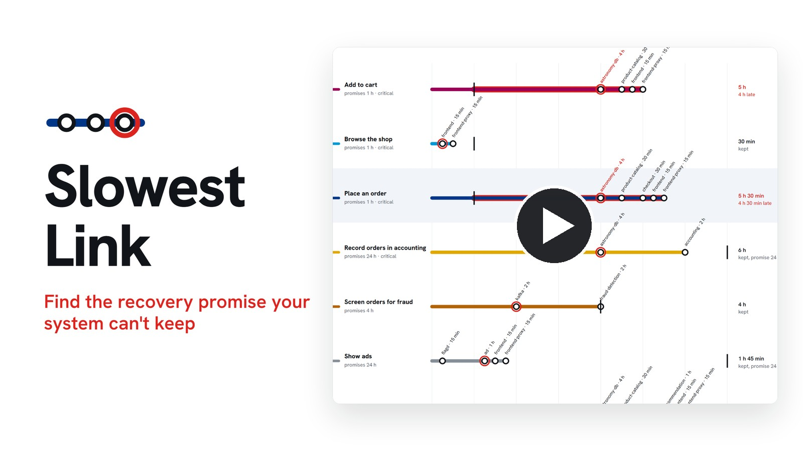

# Slowest Link

**Slowest Link finds the recovery promises a system can't keep: it checks each promise in a continuity plan against everything the function depends on, and shows the path that breaks it.**

[](https://github.com/Marc-Dvci/slowest-link/actions/workflows/tests.yml)
[](#run-it)
[](https://github.com/Marc-Dvci/slowest-link/actions/workflows/codeql.yml)
[](LICENSE)
[](https://marc-dvci.github.io/slowest-link/)

[](https://www.youtube.com/watch?v=NZ8W9UeiZ7E)

**[Watch the film](https://www.youtube.com/watch?v=NZ8W9UeiZ7E)** · **[Open the live page](https://marc-dvci.github.io/slowest-link/)**

In business-continuity audits I worked on, recovery times were set one application at a time, and nobody checked them against what each application depends on.

| Live page | Built with | Store | Headline result |
|---|---|---|---|
| [Open it](https://marc-dvci.github.io/slowest-link/) (Relate runs in the tab) | Relate by Neo4j 1.2.0: Python, CLI, MCP, WebAssembly | Markdown directory store, [`plan/`](plan/) | Predicted 39 of 40 outages on a real shop, with 4 false alarms; its architecture diagram alone raised 91 |

[For judges](#for-judges) · [See it work](#see-it-work) · [Use case](#use-case) · [How it uses Relate](#how-it-uses-relate) · [Agents](#agents) · [Results](#results) · [Run it](#run-it) · [Where the data lives](#where-the-data-lives)

## For judges

| Criterion | Where it is answered |
|---|---|
| Relate and connected context | [How it uses Relate](#how-it-uses-relate): the answers are path aggregates computed in Cypher on Relate ([`slowest_link/checks.py`](slowest_link/checks.py)); the plan is a Markdown vault Relate opens as a graph; the same queries run in the CLI, the MCP server and the browser ([parity check](web/test/parity.mjs)) |
| Functionality and completeness | [See it work](#see-it-work), [Run it](#run-it): command line, MCP server, agent skill and hook, CI guard, browser page, Docker images; 142 tests and 12 browser tests |
| Usefulness | [Use case](#use-case), [Results](#results): every finding comes from a real system, its traces and 34 outage tests on it |
| Documentation and reproducibility | [Run it](#run-it) needs no keys and no Docker; [`experiments/PROTOCOL.md`](experiments/PROTOCOL.md) and the committed evidence reproduce every number |
| Creativity | A recovery promise checked as a path through a graph, with three kinds of evidence on each edge: declared, observed, proved by a test |
| AI and agentic capabilities | [Agents](#agents): MCP tools, an agent skill, a coding-agent hook that blocks a promise-breaking change, and a measured agent evaluation |

## See it work


The page above runs Relate 1.2.0 in the browser tab, compiled to WebAssembly. It loads the plan, runs the same Cypher as the command line, and draws each function as a line. The stations are the components it waits for, in restore order; the tick is its promise; the ringed station is its slowest link. Checked one component at a time, the plan keeps every promise; followed through the published architecture, all five 1-hour promises are late; through what each function really calls, four functions are.

```text
$ python -m slowest_link guard --call "frontend->product-catalog" --for "Browse the shop"
Change: frontend -> product-catalog (sync) for Browse the shop
NEW    Browse the shop: promises 1 h, slowest link 4 h
       frontend-proxy -> frontend -> product-catalog -> astronomy-db
NEW    Browse the shop: promises 1 h, restore chain 5 h
       frontend-proxy -> frontend -> product-catalog -> astronomy-db
```

A developer adds featured products to the home page. The guard sees that "Browse the shop" now waits for the product catalogue, which waits for the database, which takes 4 hours to restore. The change fails CI before it merges.

## Use case

On 12 June 2025 a third-party cloud provider behind Cloudflare's Workers KV failed. 91% of KV requests failed and the outage lasted 2 hours and 28 minutes, taking Access, WARP, Gateway, Turnstile and other products with it[^1]. Cloudflare's customers were hit by a provider two levels down from them.

Continuity plans share that blind spot. A business impact analysis gives each function a recovery promise ("orders back within 1 hour") and lists the applications it uses. Each application's owner declares how fast it recovers. Each line can look fine on its own while the function waits for a database three calls away that takes 4 hours to restore.

European financial law asks for exactly this check. Under DORA, the business impact analysis "shall consider the criticality of identified and mapped business functions, support processes, third-party dependencies and information assets, and their interdependencies"[^2], and continuity plans must be tested at least yearly[^3]. A downtime longer than 2 hours for ICT services that support critical or important functions counts toward a major incident[^4].

Slowest Link is for the continuity lead who signs the annual recovery test plan, and for the engineer on call at 07:40 when a provider's status page turns red. It answers three questions from the graph:

1. **Which promises can't be kept?** The slowest recovery on any path under the function, and the longest restore chain, since a dependent comes back only after what it waits for.
2. **What does this outage break, and what comes back first?** A free-text notice, mapped to components by full-text search, then to functions through the graph.
3. **Will this change break a promise?** A new call between services, tried on a copy of the plan before it merges.

## How it uses Relate

- **Mode:** directory (Markdown codec).
- **Why this mode:** the continuity plan is owned by people, so it lives as one Markdown note per function, component and test: the team edits it like documents and every change is a reviewable git diff. Relate opens the folder as the graph, and the trace import and outage tests write their evidence into the same notes.
- **What the graph models:**

```text
(:Function {promise_min, critical, journeys})-[:ENTERS]->(:Service)      where the function starts
(:Function)-[:USES]->(:Service|:Datastore|:Queue)                         the plan's own list
(:Service)-[:CALLS {declared, observed, mode, journeys, calls,            a dependency, with its evidence
                    survives_without}]->(:Service|:Datastore|:Queue)
(:Service|:Datastore|:Queue {recovery_min, owner, description})           a component and its recovery time
(:Test {date, kind, affected, recovery_s})-[:EXERCISED]->(component)      an outage test on the running system
```

Each `CALLS` edge carries three kinds of evidence. `declared`: the published architecture shows it. `observed` and `journeys`: traces show it, and for which functions. `survives_without`: an outage test proved the function keeps working without it. Three views read the same graph:

| View | Edges it follows | What it shows |
|---|---|---|
| Plan | The function's own `USES` list, one component at a time | How plans are checked today |
| Architecture | Every declared call, followed through | Everything that could matter |
| Evidence | Calls in the function's own traces, synchronous, minus calls a test proved survivable | What the running system does |

| Relate surface | What it does here |
|---|---|
| Python, embedded (`relate-db`) | Every check: acyclic variable-length paths, path sums with `reduce`, `EXISTS` subqueries, per-view edge filters ([`checks.py`](slowest_link/checks.py)) |
| Markdown directory store | The plan itself, [`plan/`](plan/): notes with frontmatter properties and `[[wikilinks]]`; hand edits are picked up at the next open |
| Full-text index and `SEARCH` | The what-if maps an outage notice to components ([`whatif.py`](slowest_link/whatif.py)) |
| Read-only open | The MCP tools and the guard never write to the plan; Relate refuses a write on a read-only open |
| WebAssembly (`@relate/relate-wasm`) | The browser page runs the plan and the same queries in the tab ([`web/js`](web/js)) |
| CLI | `relate --read-only --database plan "MATCH ..."` explores the vault; `relate serve --mcp stdio --database plan --read-only` serves it to any agent |

```cypher
// The slowest link under every function, in the evidence view (slowest_link/checks.py)
MATCH (f:Function)-[:ENTERS]->(entry)
MATCH p = ACYCLIC (entry)-[rs:CALLS]->*(d)
WHERE all(r IN rs WHERE r.observed = true AND f.name IN coalesce(r.journeys, []) AND r.mode = 'sync'
          AND NOT f.name IN coalesce(r.survives_without, []))
WITH f, d, [n IN nodes(p) | n.name] AS names ORDER BY d.recovery_min DESC, size(names) ASC
WITH f, collect({component: d.name, recovery: d.recovery_min, names: names})[0] AS slowest
WHERE slowest.recovery > f.promise_min
RETURN f.name, f.promise_min, slowest
```

## How it works


Plain code decides every finding, in Cypher on Relate. Models read and explain, and an agent's numbers must come from a tool result.

1. **Seed.** [`sources/`](sources/) holds the plan's inputs: the shop's published service diagram (34 declared calls between deployed components), a business impact analysis (9 functions with their promises and supporting components) and the recovery objective of each of 20 components. `python -m slowest_link seed` writes them into the vault.
2. **Observe.** The shop ran under its own load generator, and 1,037 traces were exported from Jaeger ([`evidence/e0-traces/`](evidence/e0-traces/)). A trace's root span names its journey, so each call is recorded with the functions it serves. Producer spans make asynchronous calls, and work below a Kafka consumer serves the consumer's function.
3. **Test.** Each of the 20 components was stopped for 60 seconds, and each of 14 failure flags was turned on, while a prober replayed every journey through the front door. The predictions of all three views were committed before any test ran ([`evidence/predictions.json`](evidence/predictions.json)).
4. **Check.** Broken promises, restore chains, plan gaps, hidden and unseen calls, untested components, shared points, what-if and guard.

## Agents

| Piece | What the agent gets |
|---|---|
| MCP server, `python -m slowest_link mcp` ([`.mcp.json`](.mcp.json)) | Seven tools: `check_promises`, `explain_function`, `what_if`, `check_new_call`, `list_functions`, `get_schema` and a read-only `read_cypher` |
| Agent skill ([`.claude/skills/slowest-link/SKILL.md`](.claude/skills/slowest-link/SKILL.md), [`AGENTS.md`](AGENTS.md)) | When to use each tool, the evidence view by default, and the rule that every number comes from a tool |
| Coding-agent hook ([`.claude/settings.json`](.claude/settings.json)) | After an agent edits a note in `plan/`, the guard compares it with `HEAD`; a broken promise comes back to the agent as feedback ([a real session](examples/agent-session.md)) |
| CI guard ([`plan-guard.yml`](.github/workflows/plan-guard.yml)) | A pull request that breaks a promise or makes one worse fails, with the path on the run page |

**Agent evaluation.** Qwen 3.8 Flash answered the same 12 continuity questions three times each, in two ways, against
answers taken from the checks and committed before it ran ([`experiments/agent_eval.py`](experiments/agent_eval.py),
[`evidence/agent-eval/`](evidence/agent-eval/)):

| How the model answered | Correct | Seconds per answer | Output tokens per answer |
|---|---|---|---|
| Reading the plan's notes, pasted into its context | 36 of 36 | 85 | 5,130 |
| Calling the Slowest Link tools on Relate | 31 of 36 | 21 | 1,108 |

The vault's notes are plain enough for a model to reason over directly. Through the tools, the same questions take a
quarter of the time and a fifth of the output tokens.

## Results

Every number here is computed from the files in [`evidence/`](evidence/); the full tables, one row per test, are in
[`docs/RESULTS.md`](docs/RESULTS.md), written by `python experiments/results_report.py`. The predictions were committed
at [`9505baf`](https://github.com/Marc-Dvci/slowest-link/commit/9505baf), before the first outage test started.

### What the plan misses

| View | Broken promises | Restore chains past the promise |
|---|---|---|
| Plan (the plan's own list, one component at a time) | 0 | 0 |
| Architecture (published calls, followed through) | 5 | 5 |
| Evidence (each function's own traces, plus what the tests proved) | **3** | **4** |

Checked the way plans are checked today, every promise holds. Through what each function really calls, "Add to cart",
"Place an order" and "View a product" wait for the product database, which takes 4 hours to restore, against 1-hour
promises. "View cart" has no single component slower than its 1-hour promise, but its restore chain (front door,
frontend, cart, cart cache) takes 1 h 30 min. The plan's own list for "Place an order" leaves out 6 of the components it
depends on, the 4-hour database among them.

The published architecture is accurate about which calls exist: all 24 calls seen in 1,037 traces are in it. It cannot
say which journey uses which call, so it flags "Browse the shop" and "View cart" through the frontend's fan-out. Ten of
its declared calls appear in no trace.

### Outages on the running shop

Each of the 20 components was stopped for 60 seconds while every journey was replayed through the front door, against
predictions committed before the tests ran:

| View | Outages predicted | False alarms | Tests exactly right |
|---|---|---|---|
| Plan | 25 of 40 | 3 | 11 of 20 |
| Architecture | 40 of 40 | 91 | 2 of 20 |
| **Evidence** | **39 of 40** | **4** | **15 of 20** |

The 14 failure flags inject partial faults (a failure rate, a slowdown). The evidence view predicted every function a
flag took down, 9 of 9, with 16 false alarms where the fault stayed below the threshold; the architecture view raised
92.

The tests also corrected the graph, and the corrections are reviewable diffs in [`plan/`](plan/):

- **Kafka.** Checkout publishes each order to Kafka, and its traces mark the call asynchronous. Stopping Kafka for 60
  seconds took "Place an order" down, and orders stayed down after Kafka came back, until the services were restarted.
  The test recorded the call as `needed_by: Place an order`; the what-if "Kafka is down for 3 hours" now reports that
  promise broken.
- **Email.** Every order's trace calls the email service, yet orders kept working while it was stopped. The test
  recorded `survives_without: Place an order`, and the email service no longer counts against that promise.
- **Restarts.** Every other affected journey was back within 10.9 seconds of its component restarting.

> [!IMPORTANT]
> What is real: the system is the OpenTelemetry Astronomy Shop 3.1.0, run unmodified in Docker; the declared calls are its published architecture; the traces, outage tests and recovery times were measured on it. The promises, the plan's component lists and the recovery objectives are the plan's inputs, as a continuity team writes them ([`sources/`](sources/)).

## What it will not do

- Change the plan on its own. The MCP tools and the guard open it read-only; people edit the notes, and the trace import and the test recorder write evidence only.
- Let an agent invent a number. The skill and the server instructions require every figure to come from a tool result.

## Run it

> [!TIP]
> Nothing to install: the [live page](https://marc-dvci.github.io/slowest-link/), or a ready environment in your browser:
> [](https://codespaces.new/Marc-Dvci/slowest-link?quickstart=1)

### Setup and run

Python 3.12. No keys.

```sh
python -m venv .venv
. .venv/Scripts/activate          # Linux, macOS: . .venv/bin/activate; PowerShell: .venv\Scripts\Activate.ps1
pip install -r requirements.txt
python -m slowest_link check                       # every check, every view
python -m slowest_link explain "View cart"         # one function: slowest link and restore chain
python -m slowest_link whatif "Our managed PostgreSQL database is down. Estimated restore: 3 hours."
python -m slowest_link guard --call "frontend->product-catalog" --for "Browse the shop"
python -m http.server 8080 --directory web         # the browser page, http://localhost:8080
```

With Docker: `docker compose up web` serves the page at http://localhost:8080, and `docker compose run --rm cli` runs the checks.

In Claude Code, the repository's [`.mcp.json`](.mcp.json) offers the `slowest-link` MCP server and the skill loads from `.claude/skills/`. Any MCP client can start it with `python -m slowest_link mcp`.

To explore the vault with the Relate CLI, version 1.2.0 like the Python package ([install](https://relatedb.ai/docs/get-started/install/)):

```sh
relate --read-only --database plan "MATCH (f:Function) RETURN f.name, f.promise_min ORDER BY f.name"
relate serve --mcp stdio --database plan --read-only      # Relate's own MCP server on the plan
```

Tests: `pip install -r requirements-dev.txt`, then `python -m pytest --cov`. 142 tests run in a new random order each time; they cover 98% of the decision core's lines and 92% of its branches, and CI fails below 90%. `cd web && npm ci && node test/parity.mjs` checks that the browser code gives the command line's answers on Relate's WebAssembly build, 28 of 28 cases. `python -m playwright install chromium`, then `python -m pytest -m e2e` drives the page in Chromium: 12 tests of every section, including an axe-core scan with no serious accessibility violation.

To repeat the experiments on your own machine (Docker, about 8 GB of images), follow [`experiments/PROTOCOL.md`](experiments/PROTOCOL.md).

## Where the data lives

| Path | What it holds |
|---|---|
| [`plan/`](plan/) | **The persistent Relate store**: a Markdown directory store, one note per function, component and test |
| [`sources/`](sources/) | The plan's inputs: the published service diagram, the business impact analysis, the recovery objectives |
| [`evidence/`](evidence/) | Traces (E0), frozen predictions, outage test records (E1, E2), scores and the agent evaluation |
| [`web/data/`](web/data/) | The vault exported to one Cypher script, and the check queries, for the browser page |

## Claims

| Claim | Code | Test |
|---|---|---|
| The plan, architecture and evidence views find 0, 5 and 3 broken promises | [`checks.py`](slowest_link/checks.py) | [`test_claims.py`](tests/test_claims.py) |
| "View cart" breaks its promise only through its 1 h 30 min restore chain | [`checks.py`](slowest_link/checks.py) | [`test_claims.py`](tests/test_claims.py) |
| 1,037 traces, every one attributed; all 24 observed calls are in the published architecture | [`traces.py`](slowest_link/traces.py) | [`test_claims.py`](tests/test_claims.py), [`test_cli.py`](tests/test_cli.py) |
| The evidence view predicted 39 of 40 outages with 4 false alarms; the architecture view, 40 with 91 | [`scoring.py`](slowest_link/scoring.py) | [`test_claims.py`](tests/test_claims.py) |
| The tests wrote one needed call and two survivable calls into the plan | [`evidence.py`](slowest_link/evidence.py) | [`test_claims.py`](tests/test_claims.py) |
| The guard blocks a call that puts the 4-hour database under "Browse the shop" | [`guard.py`](slowest_link/guard.py) | [`test_cli.py`](tests/test_cli.py) |
| The browser page gives the command line's answers | [`web/js/checks.js`](web/js/checks.js) | [`parity.mjs`](web/test/parity.mjs), [`test_web_parity.py`](tests/test_web_parity.py) |
| A notice about nothing in the plan matches no component | [`whatif.py`](slowest_link/whatif.py) | [`test_whatif.py`](tests/test_whatif.py) |
| Every section of the page answers in a real browser, with no serious accessibility violation | [`web/js/app.js`](web/js/app.js) | [`test_page.py`](tests/test_page.py) |
| The MCP tools cannot write to the plan | [`mcp_server.py`](slowest_link/mcp_server.py) | [`test_cli.py`](tests/test_cli.py) |

## Layout

- `slowest_link/` the checks (`checks.py`), trace derivation (`traces.py`), what-if (`whatif.py`), guard (`guard.py`), evidence writer (`evidence.py`), scoring (`scoring.py`), MCP server and CLI
- `plan/` the Relate vault; `sources/` its inputs; `evidence/` everything measured
- `experiments/` the trace export, the prober, the test runner and the agent evaluation
- `web/` the browser page and its parity check; `tests/` the test suite

## License

[MIT](LICENSE). The shop's service diagram in `sources/` is © OpenTelemetry Authors, CC BY 4.0. The shop's checkout payloads in `experiments/people.json` come from the OpenTelemetry demo, Apache-2.0.

[^1]: Cloudflare, "Cloudflare service outage June 12, 2025", https://blog.cloudflare.com/cloudflare-service-outage-june-12-2025/
[^2]: Regulation (EU) 2022/2554 (DORA), Article 11(5), https://eur-lex.europa.eu/eli/reg/2022/2554/oj
[^3]: Regulation (EU) 2022/2554 (DORA), Article 11(6)(a): "test the ICT business continuity plans and the ICT response and recovery plans in relation to ICT systems supporting all functions at least yearly".
[^4]: Commission Delegated Regulation (EU) 2024/1772, Article 9(3)(b), https://eur-lex.europa.eu/eli/reg_del/2024/1772/oj
